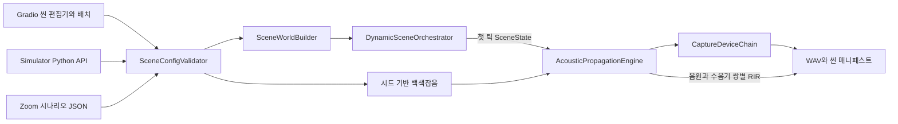

# 3D Audio Simulation → Data Generation → Domain Gap Reduction → Downstream Proof

## 1. Purpose
This document organizes the proposed program into four top-level WBS items and expands each item using the following design logic:

1. Derive **integrated capabilities** from goals and requirements
2. Perform **integrated capability decomposition**
3. Derive **unit functions** that are implementable and testable

The objective is to build a full pipeline that:
- constructs a 3D/room/spatial audio simulator,
- generates dynamic and realistic training data at scale,
- reduces the synthetic-to-real gap during model training,
- proves gains not only in separation quality but also in ASR, diarization, and localization.

---

## 2. Top-Level WBS Structure

- **W100000. 3D/room/spatial simulator construction**
- **W200000. Large-scale generation of dynamic and realistic training data**
- **W300000. Training strategy design for reducing synthetic-to-real gap**
- **W400000. Proof of improvement in separation + ASR/diarization/localization**

---

## 3. End-to-End Integrated Capabilities

### IC-01. Physically grounded 3D audio scene simulation
A system shall simulate acoustic scenes with room geometry, source/microphone placement, motion, propagation, reflection, absorption, and sensor characteristics.

### IC-02. Scalable data generation and labeling pipeline
A system shall generate large volumes of synthetic mixtures, clean references, spatial labels, metadata, and scenario manifests.

### IC-03. Domain-gap-aware model training pipeline
A system shall train separation and related models using synthetic and real data together, with calibration, adaptation, and robustness strategies.

### IC-04. Downstream task validation and operational proof
A system shall demonstrate measurable improvement in downstream tasks such as ASR, diarization, and localization under controlled and realistic conditions.

---

## 4. Cross-WBS Architecture View

### Layer A. World and acoustic simulation
Mapped mainly to **W100000**

### Layer B. Scenario synthesis and dataset factory
Mapped mainly to **W200000**

### Layer C. Model training and domain adaptation
Mapped mainly to **W300000**

### Layer D. Evaluation, benchmarking, and operational validation
Mapped mainly to **W400000**

---

## 5. Recommended Development Sequence

### Phase 1. Simulator baseline
- Static room geometry
- Static sources and microphones
- Basic RIR/BRIR generation
- Single-task speech separation baseline

### Phase 2. Dynamic scene generation
- Moving sources/microphones
- Noise/event injection
- Large-scale batch generation
- Rich metadata and label packaging

### Phase 3. Gap reduction
- Device/channel mismatch modeling
- Synthetic-real mixed training
- Domain randomization and curriculum
- Real-data calibration loop

### Phase 4. Downstream proof
- Separation + ASR + diarization + localization benchmarks
- Ablation by realism factor
- Deployment-oriented evaluation

---

## 6. File Map

- `W100000_Spatial_Simulator_Design.md`
- `W200000_Synthetic_Data_Generation_Design.md`
- `W300000_Synthetic_to_Real_Training_Design.md`
- `W400000_Downstream_Validation_Design.md`

Each file expands one top-level WBS item in the form:
- integrated capability derivation,
- decomposition,
- unit functions,
- interfaces and outputs,
- verification focus.

---

## 7. 개발 상세 설계

분석 기준은 `eb527b4`이며 검증일은 2026-11-20이다. 프로젝트의 목표는 실내 음향을 합성해 음성 분리용 학습 데이터를 만들고, 실측 데이터에서 분리·음성 인식·화자 분할·음원 위치 추정 성능을 검증하는 것이다. 현재 실행 코드는 W100000의 공간 음향 시뮬레이션에 집중되어 있다. 회의실 설정 JSON 생성과 일부 음향 연산을 확인했으며, 씬 전체 실행은 RIR 조립 단계의 함수 호출 오류로 중단된다.

| WBS | 담당 기능 | 현재 상태와 인계 산출물 |
| --- | --- | --- |
| W100000 | 방·음원·수음기 구성, 음향 전파, 수음 및 저장 | 시뮬레이터와 Gradio 진입점이 있다. 후속 데이터 생성기는 씬의 RIR, 수음 파형, 음원 참조, 메타데이터를 사용하도록 설계되어 있다. [요구사항](../W100000/requirements.md), [IF 명세](../W100000/if_list.md), [UF 명세](../W100000/uf.md) |
| W200000 | 시나리오 샘플링, 음성·잡음 합성, 정답 라벨, 데이터셋 품질 관리 | 전용 파이프라인은 설계 단계다. 회의실 JSON과 씬 배치 코드를 활용할 수 있으며, 학습 단계의 입력은 혼합음·정렬된 참조·라벨·데이터셋 매니페스트다. [W200000 설계](W200000/W200000_Synthetic_Data_Generation_Design.md) |
| W300000 | 합성·실측 데이터 혼합 학습, 시뮬레이터 보정, 도메인 적응 | 학습 및 보정은 설계 단계다. 평가 단계에 모델 체크포인트와 실험 매니페스트를 넘기고, 추정한 음향·기기 파라미터를 시나리오 생성에 반영한다. [W300000 설계](W300000/W300000_Synthetic_to_Real_Training_Design.md) |
| W400000 | 분리와 후속 태스크 평가, 요인별 성능 분석, 회귀 기준 | 평가 파이프라인은 설계 단계다. 같은 벤치마크로 모델을 비교해 태스크별 점수, 실패 사례, 배포 판정 근거를 만든다. [W400000 설계](W400000/W400000_Downstream_Validation_Design.md) |

### 7.1 W100000 실행 구조

`Simulator.run_single()`은 JSON 또는 YAML을 검증한 뒤 `simulate_scene()`을 호출한다. GUI는 씬 편집, 배치 생성, 결과 조회, 설정 입출력, Zoom 시나리오, 파일 실행 탭을 제공한다. Zoom 생성기는 인원수에 따라 방과 테이블 크기를 고르고 좌석의 입 위치를 음원으로 설정한다. 테이블 중앙에 수음기를 배치하며 TV 스피커를 선택적으로 추가한다. 생성한 JSON을 파일 실행 탭에서 불러오면 같은 `simulate_scene()`을 호출한다. [Python API](../src/simulator/simulator.py), [GUI](../app.py), [Zoom 생성기](../src/simulator/scenarios/zoom_meeting.py)

| IF 범위 | 입력과 출력 | 현재 처리 |
| --- | --- | --- |
| W111–W115 공간 구성 | `SceneConfig` → 방, `MaterialMap`, 장애물 AABB | 직육면체 경계와 면별 재질을 설정한다. `shoebox`, `corridor`, `hall`을 받아 전파 엔진에 방 치수를 전달한다. 명시 좌표가 있는 물체는 바로 배치하고, 무작위 배치에는 충돌 검사와 재시도를 사용한다. 메시 읽기 UF는 독립 호출로 제공된다. [공간 구성](../src/simulator/if_modules/scene_world.py), [방 형상 UF](../src/simulator/uf/w111_room_geometry.py), [장애물 UF](../src/simulator/uf/w113_obstacle.py) |
| W131–W134 이동·동기화 | 방 경계와 개체별 `motion` → `SourceTrajectory`, `ReceiverTrajectory`, `list[SceneState]` | 개체별 틱에서 위치·속도·방향을 생성하고, 가장 짧은 궤적 길이에 맞춰 동일 틱의 상태를 조립한다. 독립 동적 렌더러는 거리 역수의 임펄스를 RIR로 근사하고 중첩 합산으로 구간을 잇는다. [동기화 IF](../src/simulator/if_modules/dynamics.py), [틱 조립](../src/simulator/uf/w133_sync.py), [동적 렌더링 UF](../src/simulator/uf/w134_dynamic_render.py) |
| W121–W124 음향 전파 | `SceneState`, 음원별 파형 → 쌍별 `RIR`, 수음기별 `float32[N_out]` | `d/c`를 샘플 지연으로 바꾸고 `1/d` 기반 직접파를 계산한다. 방 경계의 이미지 소스 반사, Sabine RT60 기반 후기 잔향과 장애물 폐색을 RIR에 합친다. 이미지 소스 이득에는 재질의 500 Hz 흡음 계수를 사용한다. 쌍별 FFT 컨볼루션 결과를 수음기별로 더하고, 한 엔진 안에서 `(source_id, receiver_id, tick_id)`로 RIR을 캐시한다. [전파 IF](../src/simulator/if_modules/propagation.py), [이미지 소스·잔향](../src/simulator/uf/w122_reverberation.py), [RIR 조립](../src/simulator/uf/w124_rir_rendering.py) |
| W141–W144 수음 | 수음 파형 `float32[C, N_out]`, `MicSpec` → 처리 파형과 SNR·열화 메타데이터 | 주파수 응답·감도, 자기잡음·이득·클리핑, 설정된 대역 제한·코덱 근사·패킷 손실을 적용한다. 기본 실행은 수음기당 평탄한 무지향 응답을 구성한다. `ArrayConfig`와 DOA는 수음 IF의 선택 인자이며 기본 실행에서는 미연동 상태다. [수음 체인](../src/simulator/if_modules/capture.py), [씬 실행](../src/simulator/if_modules/orchestration.py) |
| W151–W155 검증·실행·저장 | 검증된 `SceneConfig` 또는 목록 → 씬 결과 또는 `ExecutionSummary` | `SimulatorOrchestrator.run_batch()`는 프로세스 풀로 씬을 실행하고 성공한 씬 ID를 체크포인트에 기록한다. GUI의 두 시뮬레이션 배치 경로는 씬을 순차 호출한다. 레이아웃·RIR 통계와 파형을 그리는 진단 유틸리티가 있다. [오케스트레이션](../src/simulator/if_modules/orchestration.py), [배치 실행기](../src/simulator/uf/w152_batch.py), [시각화](../src/simulator/uf/w154_visualization.py) |

### 7.2 설정·신호·저장 계약

| 계약 | 현재 정의 |
| --- | --- |
| 씬 입력 | 필수 키는 `scene_id`, 정수 `seed`, `room.type`, `room.dimensions`, `sources`, `receivers`다. 음원과 수음기는 각각 ID와 `position` 또는 `motion`이 필요하다. 재질·전체 모션·열화·저장 경로는 선택 설정이다. 스키마 기본값은 `1.0.0`이다. [설정 검증](../src/simulator/uf/w151_config.py) |
| 좌표와 시간 | 미터 단위의 오른손 Y-up 좌표계로 `[x, y, z]` 범위는 `[0, 0, 0]`부터 `[L, H, W]`까지다. 기본 16 kHz와 50 Hz 틱에서는 한 틱이 20 ms, 320 샘플이다. 설정이 허용하는 샘플레이트는 8/16/22.05/44.1/48 kHz이고 ISM 차수는 1~10이다. 기본 RIR 길이는 `min(4.0, max(3 × RT60, 0.5))`초다. [공유 타입](../src/simulator/types.py), [궤적·동기화](../src/simulator/if_modules/dynamics.py), [RIR 조립](../src/simulator/uf/w124_rir_rendering.py) |
| 음원과 수음 파형 | `simulate_scene()`은 각 설정 ID의 건조 음원을 시드 기반 백색잡음 `float32[N]`으로 준비한다. 수음기별 컨볼루션 합을 `[C, N_out]`으로 패딩해 수음 체인에 넘긴다. `C`와 출력 채널 순서는 설정의 `receivers`에서 정한다. [씬 실행](../src/simulator/if_modules/orchestration.py) |
| 씬 디렉터리 | 코드상 출력 위치는 `<output_dir>/<scene_id>/`다. 파일은 `receiver_<id>.wav`, `source_<id>_clean.wav`, `rir_<source_id>_<receiver_id>.wav`, `params.json`, `scene_manifest.json`이다. `params.json`에는 시드·방 치수·개체 수·샘플레이트·ISM 차수 등 요약값을 기록한다. [씬 저장](../src/simulator/if_modules/orchestration.py), [메타데이터](../src/simulator/uf/w153_metadata.py) |
| 매니페스트 | `audio_files`는 수음 WAV 목록이며 `rir_files`와 `metadata_json_path`가 RIR과 설정 요약을 가리킨다. 음향 요약은 첫 RIR의 RT60·DRR, 채널 평균 SNR, DOA 빈 값을 담는다. 궤적·이벤트, 독립 음향 요약, 데이터셋 인덱스에는 각각 내보내기 함수가 있다. [음향 요약 생성](../src/simulator/if_modules/orchestration.py), [내보내기 UF](../src/simulator/uf/w153_metadata.py) |

### 7.3 구현 격차와 수용 기준

| 개발 순서 | 확인한 동작 | 구현 및 검증 기준 |
| --- | --- | --- |
| 1. RIR 호출 복구 | `generate_rir()`이 `generate_static_rir_with_mic()`에 정의되지 않은 `src_pos`를 전달해 `TypeError`가 난다. 정적 씬과 Zoom JSON에서 출력 파일이 생성되기 전에 중단됐다. | 호출 인자를 UF 시그니처에 맞춘다. 정적 1음원·1수음기와 Zoom JSON이 각각 WAV·RIR·매니페스트 저장까지 완료되어야 한다. [호출부](../src/simulator/if_modules/propagation.py), [RIR UF](../src/simulator/uf/w124_rir_rendering.py), [통합 테스트](../tests/integration/test_orchestration.py) |
| 2. 씬 ID·좌표 보존 | 궤적 생성기가 개체별 `motion`만 넘겨 각 개체의 설정 ID와 `position`을 잃는다. 4인+TV 씬에서 음원 5개가 모두 `source_0`이 되었고 첫 음원 위치도 바뀌었다. 이 ID는 RIR 캐시와 믹싱에 쓰인다. | 궤적과 `SceneState`까지 설정 ID와 정적 좌표를 보존하고 이동 입력의 우선순위를 명시한다. 2음원·2수음기 씬에서 네 쌍이 고유하며 각 수음기에 해당 두 음원이 합성되는지 확인한다. [궤적 IF](../src/simulator/if_modules/dynamics.py), [소스 궤적 UF](../src/simulator/uf/w131_trajectory.py), [렌더링 IF](../src/simulator/if_modules/propagation.py) |
| 3. RIR 신호 검증 | 정적 RIR 테스트에서 직접파 피크 오차와 `NaN`이 확인됐다. 후기 잔향 시작이 RIR 끝에 도달하면 빈 배열의 RMS를 구하는 경로가 두 조립 함수에 있다. | 잔향 유효 구간을 확인하고 정규화·혼합 규칙을 공통화한다. 제어된 1 m 조건에서 16 kHz 직접파가 47±1 샘플에 위치하고, 잔향이 없거나 짧은 조건의 RIR과 DRR이 모두 유한한지 검증한다. [RIR 조립](../src/simulator/uf/w124_rir_rendering.py), [RIR 단위 테스트](../tests/unit/test_w124_rir_rendering.py) |
| 4. 출력 형식과 GUI 표시 | WAV writer는 PCM 형식 태그 `1`에 `float32` 바이트를 저장하며 SciPy 읽기에서 `int32`로 해석됐다. 매니페스트의 `source_count`는 `1`로 고정되고 건조 참조 WAV 경로가 빠져 있다. Scene Editor 요약은 `None`인 DOA에 숫자 포맷을 적용한다. | `float32` WAV를 표준 writer로 기록하고 저장 후 샘플·샘플레이트를 다시 읽어 확인한다. 실제 개체 수, 쌍별 RIR과 참조 경로를 스키마에 기록하고 모든 파일 참조를 검증한다. DOA 결측 표시는 GUI에서 처리한다. [WAV writer](../src/simulator/if_modules/orchestration.py), [매니페스트](../src/simulator/uf/w153_metadata.py), [Scene Editor](../app.py) |
| 5. 설정·배치 일관성 | 전역 `motion.duration_s`가 개체 참조 오류 경고를 만들며 모션과 파형의 기본 길이는 각 10초와 5초다. 전파 엔진은 음속 기본값 343 m/s를 사용한다. Facade의 출력 경로 인자와 씬 실행이 읽는 설정 경로가 다를 수 있다. 파일 실행 탭은 worker 수 입력을 받으며 씬을 순차 호출하고 개별 실패 후에도 완료 메시지를 표시한다. | 씬 시간축·음속·출력 경로를 실행 전 해석하고 개체 설정과 전역 설정을 구분해 검증한다. 성공·실패 건수를 구분하고, 체크포인트 재개에서 완료 산출물과 재실행 대상이 일치하는지 검증한다. [설정 교차 검증](../src/simulator/uf/w155_validation.py), [Facade](../src/simulator/simulator.py), [배치 실행기](../src/simulator/uf/w152_batch.py), [GUI](../app.py) |
| 6. 시변 음향과 센서 연동 | 독립 동적 경로의 샘플 매핑은 50 Hz로 고정되어 있다. 바이노럴 UF는 합성 HRTF를 사용한다. | 동일 시간축에서 위치 변화가 5 cm를 넘을 때 RIR을 다시 계산하고 구간 경계를 교차 페이드한다. 정적 입력에서 정적 경로와 일치하고, 이동 입력에서 지연·DOA가 틱에 맞게 변하는지 확인한다. REQ-W06의 20 ms 구간 경계 불연속 목표는 −60 dB 미만이다. 마이크 배열의 위치·시계 오차와 HRTF를 각 기능의 수용 시험에 연결한다. [동적 렌더링](../src/simulator/uf/w134_dynamic_render.py), [BRIR](../src/simulator/uf/w124_rir_rendering.py), [요구사항](../W100000/requirements.md) |

명시 위치 배치의 허용 범위도 시나리오 계약에 포함해야 한다. Zoom 4인 예제에서 0.3 m 장애물 이격 검사로 TV의 벽 접촉, 가구의 바닥 접촉, 의자 간 간격을 포함해 8건을 경고했다. 바닥·벽에 접하는 설치 물체와 실제 겹침을 구분하는 검증이 필요하다. Zoom은 최대 12인과 선택적 TV 음원을 생성하며 기존 W100000 설계의 동시 음원 상한은 8이다. 생성기와 실행기의 수용 범위를 맞춰야 한다. [Zoom 레이아웃](../src/simulator/scenarios/zoom_meeting.py), [충돌 검사](../src/simulator/uf/w113_obstacle.py), [시뮬레이터 제약](../W100000/assumptions_and_constraints.md)

### 7.4 학습 데이터에서 후속 평가까지

| 작업 | 상세 설계와 인계 조건 |
| --- | --- |
| W210000·W220000 시나리오와 음원 구성 | 시드, 화자·방·잡음 원본 ID, 음원 구간의 샘플 인덱스, 목표 SNR과 중첩률을 씬 계획에 기록한다. 음성·잡음을 목표 샘플레이트로 맞추고 발화 순서와 중첩 이벤트를 구성한 뒤 W100000에 음원 ID별 파형과 씬 설정을 전달한다. [데이터 생성 설계](W200000/W200000_Synthetic_Data_Generation_Design.md) |
| W230000·W240000 렌더링과 데이터 품질 | 음원과 수음기 쌍별 컨볼루션 결과를 유지해 혼합 `[C, T]`와 참조 `[S, C, T]`를 공통 시간축에 맞춘다. VAD·화자 ID·위치·DOA 라벨을 같은 샘플 인덱스로 저장한다. 매니페스트에 파일 경로와 설정·데이터 버전을 넣고, 무음·클리핑·비유한 값·길이 불일치를 검사한다. REQ-202·204·206의 시험 기준은 목표 SNR ±1 dB, 라벨 동기화 오차 1 ms 미만, 분할 간 화자·방·잡음 ID 교집합 0건이다. [데이터 생성 요구사항](W200000/W2_requirements.md) |
| W310000–W340000 학습과 보정 | 버전이 고정된 합성·실측 매니페스트로 합성 전용, 실측 전용, 혼합 학습을 구성한다. 실측 RT60·잡음·기기 특성으로 시뮬레이터 파라미터를 보정하고 보정에 사용한 데이터 ID를 기록한다. 설정, 샘플링 비율, 시드, 데이터 버전과 체크포인트를 실험 매니페스트에 남긴다. [학습 설계](W300000/W300000_Synthetic_to_Real_Training_Design.md), [학습 요구사항](W300000/W3_requirements.md) |
| W410000–W440000 검증 | 홀드아웃 벤치마크에서 기준 모델과 후보의 SI-SDRi, WER, DER, 위치·추적 오차를 같은 조건으로 측정한다. ASR·화자 분할 모델 버전과 벤치마크 버전을 고정하고 이동·잔향·잡음별 결과와 제거 실험을 남긴다. REQ-401은 지정 합성 벤치마크에서 SI-SDRi 8 dB 이상, REQ-402는 지정 실측 벤치마크에서 WER 상대 15% 이상, DER 절대 5%p 이상 감소를 목표로 한다. [후속 평가 설계](W400000/W400000_Downstream_Validation_Design.md), [평가 요구사항](W400000/W4_requirements.md) |

### 7.5 검증 결과

- 프로젝트 `.venv`가 `pyvenv.cfg`를 찾지 못해 시스템 Python 3.14.3과 pytest 9.0.2를 사용했다. 워크스페이스 임시 디렉터리를 `--basetemp`로 지정해 기존 테스트 440개를 실행했고 **423개 통과, 17개 실패**를 확인했다.
- 실패 17개는 전파·오케스트레이션의 RIR 인자 오류 9개, 정적 RIR 단위 테스트 3개, 패킷 손실 범위 계약 2개, 장애물 배치·waypoint 종점·SNR 각 1개다. 패킷 손실 구현은 허용 범위 `[0, 0.2]` 밖을 경고 후 제한한다. SNR 테스트의 기대값을 해석할 때는 정현파의 피크 dBFS와 RMS 기준을 명시해야 한다. [오케스트레이션 테스트](../tests/integration/test_orchestration.py), [전파 테스트](../tests/integration/test_propagation.py), [코덱 테스트](../tests/unit/test_w144_codec.py), [잡음 테스트](../tests/unit/test_w143_noise_gain.py)
- 별도 스모크 검증에서 1 m 직접파 지연 47 샘플, Zoom 4인+TV의 음원 5개·수음기 1개·장애물 6개, 배치 시나리오 JSON 5개 저장을 확인했다. 정적 Python API와 Zoom 파일, Gradio의 씬 편집·파일 실행 콜백은 RIR 인자 오류를 재현했다. GUI 검증 범위는 콜백 직접 실행이다.
- 처리량 수치는 요구사항의 목표다. REQ-W04는 16 kHz·ISM 3차에서 1,000 RIR/s 이상, REQ-W10은 8코어 CPU에서 10초·2음원·4수음기 조건의 시간당 1,000씬 이상을 목표로 한다. 실측은 정상 씬 저장과 형식 검증을 통과한 뒤 같은 조건에서 수행한다. [요구사항](../W100000/requirements.md), [성능 검증 계획](../W100000/verification_plan.md)
