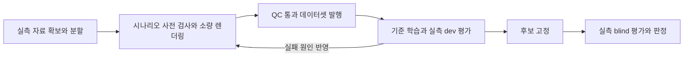

# AudioSeparation 프로젝트 설계 검토

2026-11-20 · 검토 모드 A · 기준 커밋 `eb527b4`와 작업본의 WBS 개요 §7

## 결론

가장 큰 맹점은 **한 씬에서 만든 혼합음과 정답을 학습기가 읽고, 실제 회의 데이터에서 기준 모델과 비교하는 흐름**에 실행 가능한 인계 및 합격 조건이 부족하다는 점이다. WBS에는 시뮬레이션, 데이터 생성, 학습, 검증의 기능 목록이 있다. 설계를 개정할 때는 각 단계가 어떤 산출물을 넘기고 누가 어떤 근거로 다음 단계의 입력으로 받아들이는지부터 명시해야 한다. [상위 WBS §4·§7.4](../design_md/WBS_Overview_3D_Audio_Separation.md)

첫 검증 범위로 **16 kHz, 정적 회의실, 두 화자, 고정 참조 마이크, 음성 분리와 ASR**을 제안한다. 깨끗한 입력과 실측 데이터의 사용 권한을 확인한 뒤, 소규모 데이터셋 1개를 렌더링부터 실제 회의 성능 비교까지 통과시키면 다음에 추가할 이동, 배열, 기기 열화 기능을 측정 근거로 고를 수 있다. 이 범위와 아래 우선순위는 설계 개정안이다.

## 1. 맹점, 한계와 개선 방안

### P0 · 첫 종단 간 검증에 필요한 설계

| 발견 | 근거와 영향 | 설계 개정안 및 수용 기준 |
| --- | --- | --- |
| **F-01. 정상 씬을 저장하는 경로가 중단된다** | `generate_rir()`가 하위 함수에 정의되지 않은 `src_pos`를 전달한다. 전파·씬 실행 시험 9건에서 같은 예외를 재현했다. 별도로 정적 RIR에서 직접파 피크 오차와 NaN을 재현했고, WAV 쓰기 함수를 SciPy로 다시 읽었을 때 float32 원본이 int32로 해석됐다. 오류가 복구되어도 파일 존재 검사만으로는 학습 입력 무결성을 보장할 수 없다. [전파 호출부 136행](../src/simulator/if_modules/propagation.py#L136) [WAV 저장 320행](../src/simulator/if_modules/orchestration.py#L320) [기존 WBS §7.3](../design_md/WBS_Overview_3D_Audio_Separation.md) | 공통 실행 경로에서 1음원·1수음기 기준 씬과 2음원·2수음기 씬을 저장한다. 정의된 직접파 지연, 유한 파형·RIR, 네 쌍의 고유 참조, 선언된 WAV 인코딩과 샘플 왕복, 매니페스트의 파일·ID 일치까지 검사한다. 같은 시험을 Python API와 GUI 파일 실행 경로에 연결한다. |
| **F-02. 학습 정답 신호와 시간 기준이 정해지지 않았다** | W1 정상 진입점은 백색잡음을 만들고, 전파 IF는 음원별 컨볼루션을 수음기별로 합산한다. W2는 무반향 참조와 공간화 참조를 모두 열어 두고 1 ms 미만 라벨 정렬을 요구한다. 건조 발화와 수음 파형은 전파 지연, 리샘플링, 자르기, 기기 처리에 따라 서로 다른 시간축을 갖는다. 클리핑 같은 비선형 처리 뒤의 혼합음에도 참조를 각각 처리해 더하는 규칙을 적용하면 정답이 틀릴 수 있다. 중복 음원 ID도 검증을 통과했다. [씬 실행 222행](../src/simulator/if_modules/orchestration.py#L222) [전파 IF 184행](../src/simulator/if_modules/propagation.py#L184) [W2 참조 설계 118행](../design_md/W200000/W200000_Synthetic_Data_Generation_Design.md#L118) [REQ-202~204](../design_md/W200000/W2_requirements.md) | W2가 음원 ID별 파형과 발화 구간을 넘기고 W1이 수음기별 혼합음 `[C,T]`, 음원별 수음 참조 `[S,C,T]`, 잡음·간섭 성분과 적용된 시간 변환을 돌려주는 계약을 정의한다. 첫 프로필은 **마이크 위치에서 렌더링한 기기 열화 전 파형**을 분리 정답으로 제안한다. 발화 시각과 참조 마이크 도달 시각, 기준 채널, 공통 샘플 인덱스, 무음·잔향 꼬리·잘림 처리, DOA 좌표계와 보간을 지정한다. 열화 전에는 성분 합을, 열화 후에는 정렬 및 유효 구간을 검증한다. 16 kHz에서 15·16샘플의 정렬 경계를 시험한다. 활성 발화 창과 기준 채널에서 렌더링 성분별 RMS로 SNR을 계산하고, 중첩률의 분모와 무음 구간 처리도 고정한다. |
| **F-03. 실측 자료의 확보와 검수 작업이 빠져 있다** | W3는 제한된 실측 라벨과 비라벨 녹음을 가정하고, W4는 깨끗한 참조 파형·전사·화자 시각과 위치 정답을 태스크별로 요구한다. 실측 등록, 큐레이션, 주석 신뢰도 기록은 설계에 있다. 실제 사용 가능한 녹음과 정답의 조합, 수집·동의 확인·동기화·검수의 책임과 완료 조건이 정해지지 않았다. 실제 혼합음만 확보하면 정답 파형이 필요한 점수와 지도 분리 학습을 직접 수행할 수 없다. [W3 데이터 제약 5행](../design_md/W300000/W3_assumptions_and_constraints.md#L5) [REQ-301 8행](../design_md/W300000/W3_requirements.md#L8) [W4 실측 벤치마크 94행](../design_md/W400000/W400000_Downstream_Validation_Design.md#L94) [W4 정답 결측 조건](../design_md/W400000/W4_assumptions_and_constraints.md) | 녹음의 사용 범위·출처와 보유 라벨을 세션 단위로 등록하고, 참조 마이크·배열 배치·동기화·기기 DSP 적용 여부를 확인한다. 태스크별로 참조 파형, 전사, 화자 타임라인, 위치 정답의 최소 수량과 검수 표본을 결정한다. 매니페스트에 라벨의 출처와 유효 여부를 기록한다. 합성 전용·실측 전용·혼합 각각의 필수 참조와 사용할 손실을 정의하고, 정답 결측 시 허용할 학습 모드를 명시한다. 평가 리포트에 지표별 유효 분모를 표시한다. |
| **F-04. 데이터 누수 차단이 모델 개선 루프에 연결되지 않았다** | W4가 실측 dev와 blind-test 분리를 명시한다. W3는 홀드아웃 실패를 보정·커리큘럼에 환류하고 실측 벤치마크로 모델을 고르므로, 두 경로가 사용할 분할을 고정해야 한다. W2 REQ-206의 합격 조건은 Test 대 Train/Val의 화자·잡음만 검사해 Train–Val 교집합과 방 누수를 놓친다. W4 REQ-403의 서버 간 해시 일치만으로는 모든 서버가 같은 잘못된 버전을 읽은 경우를 검출할 수 없다. [W3 개선·선택 142행](../design_md/W300000/W300000_Synthetic_to_Real_Training_Design.md#L142) [W4 실측 분할 97행](../design_md/W400000/W400000_Downstream_Validation_Design.md#L97) [REQ-206 93행](../design_md/W200000/W2_requirements.md#L93) [REQ-403 42행](../design_md/W400000/W4_requirements.md#L42) | 원본 자산을 묶어서 **합성 전** 분할한다. 화자와 원본 녹음·세션·방·잡음의 유효 키를 명시하고, 모든 금지 교집합 및 원본 중복을 검사한다. 기기 홀드아웃의 적용 조건은 벤치마크마다 정의한다. 학습·보정·실패 분석·모델 선택은 허용된 train/dev 버전을 사용하고 blind-test는 고정된 후보의 승인에만 사용한다. 로더는 선언된 벤치마크 매니페스트의 기대 해시를 검증한다. 같은 세션을 두 용도로 등록했을 때 실패하는 시험을 둔다. |
| **F-05. 평가기의 정확성과 모델의 성능이 한 수용 기준에 묶였다** | REQ-401은 추정음과 참조음만 입력으로 두고 혼합음 대비 개선량인 SI-SDRi를 요구한다. 1시간 입력을 1시간 이내에 끝내는 시험은 RTF < 0.5를 입증하지 못한다. W4 ASR·화자 분할 설계도 분리 스트림의 전사 결합, 화자 재할당, 평가 시간축을 지정하지 않았다. 평가 구현을 바꾸는 것만으로 모델 순위가 바뀔 수 있다. [REQ-401 8행](../design_md/W400000/W4_requirements.md#L8) [W4 태스크 평가 64행](../design_md/W400000/W400000_Downstream_Validation_Design.md#L64) | 혼합음 기준 채널, 평가 구간, 화자 순열 매칭과 누락·추가 화자 처리, ASR 텍스트 정규화와 다중 스트림 집계, DER 중첩·경계 처리 규칙을 고정한다. 다채널은 대표 채널 또는 채널별 집계 방식을 지정한다. 도구 정확성은 점수를 미리 계산한 작은 예제로, 실행 속도는 고정 장비에서 1시간 입력 기준 **30분 미만**으로, 모델 점수는 버전 고정 벤치마크로 확인한다. |
| **F-06. 어떤 결과를 성공으로 판정할지 모호하다** | W3의 WER 3%p 감소는 기준 모델 출력과 비교하고, W4의 15% 상대 감소는 분리 없는 입력과 비교한다. W3는 DER·SDR도 출력으로 적었으며 합격 기준은 WER에만 있다. REQ-405의 허용폭은 “1% 미만”인데 0.5% 악화를 실패로 보는 사례의 정확한 임계값과 단위가 없다. 위치·추적은 W414에 기능이 있으나 W4 요구사항에 독립 수용 기준이 없다. [REQ-305 73행](../design_md/W300000/W3_requirements.md#L73) [REQ-402·405](../design_md/W400000/W4_requirements.md) [W414 82행](../design_md/W400000/W400000_Downstream_Validation_Design.md#L82) | 같은 세션에서 **원음 / 고정 기준 분리 모델 / 후보 모델**을 비교한다. 지표별 절대·상대 변화량, 비교 기준 모델, 최소 평가 표본과 결측 처리, 필수 조건별 허용 하락폭, 경계값·동률·기준 WER 0의 판정을 표로 고정한다. 세션 단위 쌍 비교로 불확실성을 읽고, 평균과 주요 조건별 하락을 함께 본다. 위치 추정을 출시 범위에 넣을 때는 각도·거리·추적 단절 지표와 참조 좌표계를 별도 요구사항으로 정의한다. |

### P1 · 운영과 실험을 반복하기 위한 설계

| 발견 | 근거와 영향 | 설계 개정안 및 수용 기준 |
| --- | --- | --- |
| **F-07. 시나리오 작성·미리보기·실행이 같은 설정을 공유하지 않는다** | Zoom 4인 JSON을 Scene Editor 콜백으로 불러와 설정을 재구성하니 음원 **4→3**, 장애물 **6→0**, 첫 음원 ID **`person_0`→`s0`**로 바뀌었다. UI는 4명을 불러왔다고 표시했다. YAML을 받는 입력도 콜백에서는 JSON 파서를 쓴다. 파일 실행 탭은 워커 입력을 받으나 순차 실행하며, 개별 실패가 있어도 마지막에 요청 건수로 완료를 표시한다. [GUI 설정 조립 152행](../app.py#L152) [가져오기 323행](../app.py#L323) [파일 실행 913행](../app.py#L913) [사용 매뉴얼 §3](../USER_MANUAL.md) | GUI와 API가 동일 스키마와 해석기를 쓴다. 편집기가 다루는 필드만 갱신하고 미편집 필드와 ID를 유지한다. 처리 가능한 프로필, 적용 중인 기본값, 지원 밖 항목, 예상 작업량을 사전 검사에 표시한다. 미리보기와 실행의 해석된 설정을 비교하며, 알려진 Zoom JSON을 저장 후 다시 열었을 때 씬 서명이 유지되는지 시험한다. |
| **F-08. 부분 실패 이후 완료 판정이 실제 산출물과 분리된다** | 체크포인트는 완료된 `scene_id` 목록이다. 같은 ID로 시드를 변경하고 출력 폴더가 없는 상태에서 재개하자 대기 건수가 0으로 나왔다. 씬 실행은 최종 경로에 파형부터 차례로 쓰고 매니페스트는 파일 누락을 경고로 처리한다. 장애 후 부분 파일이 남거나 변경된 작업이 완료로 건너뛰어질 수 있다. [REQ-201 8행](../design_md/W200000/W2_requirements.md#L8) [배치 큐 62행](../src/simulator/uf/w152_batch.py#L62) [씬 저장 262행](../src/simulator/if_modules/orchestration.py#L262) [매니페스트 검사 270행](../src/simulator/uf/w153_metadata.py#L270) | 해석된 설정, 입력 자산 해시, 렌더러 버전으로 작업을 식별한다. 시나리오 중복 검사는 표시 ID 변경에 영향받지 않는 렌더링 조건으로 수행한다. 임시 저장 후 산출물과 체크섬 검증을 통과한 묶음을 확정하고, 완료·실패·재개·QC 탈락 이유를 남긴다. 동일 작업은 재사용하고 시드 변경, 산출물 삭제, 작업 중단 사례는 필요한 씬만 재실행되는지 시험한다. |
| **F-09. 지원 범위와 물리적 합격 조건을 함께 조정해야 한다** | 정상 씬 실행은 첫 틱으로 렌더링하며 초기 반사 계수는 500 Hz 대역을 쓴다. 배열 오차 옵션은 수음 체인에서 파형을 바꾸는 앞단 입력으로 연결되지 않았다. `+12 dB`로 설정한 두 번째 수음기의 시험 입력이 첫 채널과 같은 수준으로 나온 것도 확인했다. REQ-W03의 2마이크 TDOA 한 값으로 임의의 3D 방위를 유일하게 구할 수 없다. 배열 축에 수직인 두 방향이 같은 지연차를 내는 경우가 있다. [첫 틱 렌더링 232행](../src/simulator/if_modules/orchestration.py#L232) [대역 처리 104행](../src/simulator/uf/w122_reverberation.py#L104) [채널 이득 132행](../src/simulator/if_modules/capture.py#L132) [배열 처리 250행](../src/simulator/if_modules/capture.py#L250) [REQ-W03 38행](../W100000/requirements.md#L38) | 정적·이동·배열·바이노럴 프로필별 지원 입력과 검증된 물리량을 명시한다. 배열 위치 오차는 전파 계산 전에, 채널 시계 오차는 파형 시간 변환에 적용하고 명목·유효 기하를 저장한다. TDOA 시험을 직접파 지연차 검증과 제한된 관측 조건의 방향 복원 시험으로 나눈다. 이동 프로필에서는 정적 입력 동등성 및 이동 중 지연·DOA·구간 경계 변화를 검증한다. |
| **F-10. 도메인 보정·적응의 채택 기준이 실제 이득을 충분히 가려내지 못한다** | REQ-302의 RT60 분포 일치로 재질·공간·기기 파라미터 조합을 유일하게 식별할 수 없다. REQ-304의 BCE 0.69는 모든 입력에 0.5를 반환하는 판별기도 만족한다. W3 보정은 시뮬레이터 YAML을 내보내고, W2는 샘플링 분포를 받는다. 두 버전 간 적용 규칙이 없다. REQ-404에서 각 요인을 따로 제거한 점수로는 서로 영향을 주는 요인의 기여를 분리하기 어렵다. [REQ-302·304](../design_md/W300000/W3_requirements.md) [W2 시나리오 분포 12행](../design_md/W200000/W2_requirements.md#L12) [REQ-404 57행](../design_md/W400000/W4_requirements.md#L57) | 보정 가능 파라미터와 실측 관측량을 대응시키고, 적합에 사용하지 않은 dev 세션에서 대역별 잔향, 직접음 대비 잔향, 거리·기기별 통계와 다운스트림 성능을 확인한다. 보정 프로필에 독립 측정 참조와 분포 추정법을 기록하고, 승인된 범위와 데이터 버전이 W2 생성 매니페스트에 반영되는지 시험한다. 실험 간 데이터·모델 예산·시드를 고정하고 효과가 큰 요인의 조합도 비교한다. BCE와 분포 거리에는 진단 역할을 주고, 실제 채택은 dev 태스크 이득과 주요 조건의 회귀 판정에 연결한다. |
| **F-11. 대량 생성 예산이 사용 가능한 데이터셋 규모로 환산되지 않았다** | W2는 1,000코어에서 일주일 내 10만 시간을 목표로 한다. 16 kHz float32라면 10만 시간의 모노 파형은 **23.04 TB**이며, 4채널 혼합음과 두 화자의 4채널 참조를 함께 저장하면 **276.48 TB**다. 압축·RIR·부가 정보는 이 계산 범위 밖이다. W1의 8코어당 10초 씬 1,000개/시간을 1,000코어에 선형 적용하면 일주일에 약 **5.83만 오디오 시간**이다. W2에 기재된 `50x per core`의 기준 실행도 정해지지 않았다. [W2 규모 제약 5행](../design_md/W200000/W2_assumptions_and_constraints.md#L5) [REQ-W10 148행](../W100000/requirements.md#L148) | 파일럿에서 **QC 통과 오디오 시간/시간**, 씬당 저장량, 쓰기·학습 로딩 시간, 재시도·탈락률을 함께 측정한다. 학습에 필요한 참조만 포함하는 저장 프로필과 샤드 크기를 고른다. 헤드룸 위반, 실제 클리핑, 의도한 스트레스 조건에 각각 QC 처분을 정한다. QC 탈락으로 희귀 조건이 부족해지면 보충 생성한다. |
| **F-12. 요구사항의 기준 문서와 실행 증거 연결이 약하다** | W1 상세 요구사항은 방 최대 크기를 50×50×20 m로 두고, 별도 W1 제약은 직육면체 각 변 1–30 m와 부피 10–5,000 m³를 둔다. 적용 버전·우선순위가 명시되지 않아 같은 입력의 합격 판정이 달라질 수 있다. W2–W4 요구사항에 기재된 시험 경로 16개를 `tests/`에서 확인했으며 일치 경로는 0개였다. 시험 및 증거 파일명은 검증 계획으로 읽는 것이 맞다. [W1 요구사항 15행](../design_md/W100000/W1_requirements.md#L15) [W1 제약 11행](../W100000/assumptions_and_constraints.md#L11) [W2 요구사항](../design_md/W200000/W2_requirements.md) [W3 요구사항](../design_md/W300000/W3_requirements.md) [W4 요구사항](../design_md/W400000/W4_requirements.md) | WBS별 기준 요구사항과 적용 프로필을 지정하고, 기존 REQ ID의 대응과 장래 항목을 기록한다. 필수 요구사항마다 실제 입력 스키마, 소유 단계, 자동 검사, 증거 파일, 실패 시 담당 역할을 연결한다. 릴리스 완료 조건은 해당 버전에서 수행한 검사 결과와 묶는다. |

## 2. 워크플로우 관점에서 추가할 기능

| 순서 | 필요한 기능 | 다음 단계로 넘기는 조건 |
| --- | --- | --- |
| **1. 대상 정의와 실측 확보** | 대표 회의 유형, 분리 후 사용할 ASR·화자 분할·위치 추정의 우선순위, 입력 채널과 녹음 위치, 사용 가능한 실측과 주석을 등록한다. | 최소 검증 범위와 실측 dev/blind 분할, 평가 지표별 정답 확보 여부를 확인한다. **F-03·04·06** |
| **2. 시나리오 사전 검사와 소량 검증** | 원본 설정을 보존하고 정규화된 값과 경고를 보여준다. 소수 씬에서 3D 배치, 혼합음과 각 참조 청취, 파형·타임라인·DOA를 같은 씬으로 확인한다. | 두 화자의 구간과 수음기별 참조가 맞고, 실패한 설정을 원본부터 다시 열 수 있다. **F-01·02·07·09** |
| **3. 생성, QC, 데이터셋 발행** | 실행 ID와 진행 상태를 저장하고, 이유별 격리·선택 재실행·버전별 샤딩을 제공한다. | 고정 매니페스트에서 누수·파일·샘플 검사가 통과하고, 데이터 로더가 원본 위치에 의존하지 않고 한 배치를 읽는다. **F-04·08·11·12** |
| **4. 기준 모델 학습, 개발 평가, 개선 환류** | 입력 데이터 버전, 환경, 시드, 체크포인트, 기준 평가기를 묶는다. 개발셋의 실패를 라벨·시뮬레이션·모델·후처리 원인으로 분류해 해당 단계의 다음 변경으로 연결한다. | 처음부터 같은 기준 실험을 다시 추적할 수 있고, 새 후보의 이득과 하락을 같은 세션에서 비교할 수 있다. **F-05·06·10** |
| **5. 고정 후보 판정 및 추론 인계** | 정답을 숨긴 실측 평가를 수행하고 승인 결과를 저장한다. 데모나 운영에 인계할 경우 채널 순서·샘플레이트·스트림 조립, 지연 예산, 실패 시 원음 전달이나 직전 승인 모델로 복귀하는 조건을 묶는다. | 평가 규칙과 체크포인트, 입력 프로필을 고정한다. 실패나 데이터 부족을 후보 성공과 구별할 수 있다. **F-04·06** |

우선 **1단계의 실측 자료 확인·평가 규칙 설계와 2단계의 W1 실행 복구를 병행**한다. 이어 정적 씬 소량을 데이터 로더, 기준 학습, 고정 실측 dev 평가까지 연결한다. 대표 조건에서 어떤 실패가 반복되는지 측정한 뒤 이동, 배열, 기기 모델, 데이터 규모의 확장 순서를 결정한다.

## 3. 검증과 기존 검토 대조

### 기계 검사

- 저장소에는 설정된 `tools/graph_checks.py`와 `graph/edges.csv`가 없었다. 기존 pytest 전수, 명세의 시험 경로 대조, 공개 실행에서 사용하는 개별 함수의 입력·출력 확인을 수행했다.
- 시스템 Python 3.14.3과 pytest 9.0.2에서 440개 중 **423개 통과, 17개 실패**. RIR 인자 불일치 9건, 정적 RIR 3건, 패킷 손실 범위 2건, 장애물 배치·waypoint 종점·SNR 각 1건이었다. [전파·씬 통합 시험](../tests/integration) [정적 RIR 단위 시험](../tests/unit/test_w124_rir_rendering.py)
- 별도 확인에서 WAV 원본 `[-0.5, 0, 0.5]`의 int32 재해석, `scene_id`가 같은 변경 작업의 재개 누락, 두 번째 수음기 이득 미반영, Zoom 설정 왕복 손실, 중복 음원 ID 통과를 재현했다. GUI 확인은 Python 콜백 직접 호출을 사용했다.

### 범위 및 대조

- 메인 검토는 WBS 전체 설계와 W1 요구사항·기존 리뷰·공개 실행 경로를 다뤘다. 독립 감사자 1명에게 상위 WBS §1–6 및 W2–W4 설계·요구사항·제약 문서 총 10개를 전달했다. 독립 검토의 세부 지적은 원문 및 기존 설계와 대조해 F-02~06, F-08, F-10~11에 반영했다.
- 별도 이슈 대장이 발견되지 않아 WBS 개요 §7, W1 설계 분석과 커버리지 검토, 단계 진단, 구현 보고서를 비교 기록으로 사용했다. [기존 W1 설계 분석](../W100000/design_analysis_report.md) [W1 커버리지](../W100000/uf_if_coverage_review.md) [기존 구현 보고서](../reports/impl/uf_impl_report_20260321.md)

| 구분 | 건수 | 대조 결과 |
| --- | --- | --- |
| 재발 | 5 | F-01 기존 실행·저장 오류, F-02 시간 정렬과 데이터 인계, F-07 배치 진입점 차이, F-08 체크포인트 검증, F-09 동적·수음 지원 범위 |
| 신규 | 7 | F-03 실측 정답 확보 절차, F-04 분할과 환류 정책, F-05 평가기 입력·시간 조건, F-06 성능 판정, F-10 적응·보정 채택 기준, F-11 규모 환산, F-12 기준 요구사항 적용 범위 |
| 이전 항목 해소 확인 | 1 | 이전 구현 보고서 NOTE-01의 1차 ISM 이미지 소스 개수. 차수 필터를 코드에서 확인했고 해당 단위 시험이 통과했다. [반사 구현](../src/simulator/uf/w122_reverberation.py) [반사 단위 시험](../tests/unit/test_w122_reverberation.py) |

채택 12건 중 **치명 1건**은 정상 실행을 중단시키는 F-01이다. 나머지 **경고 11건**은 데이터·운영 계약과 수용 기준에 영향을 준다. 위 우선순위는 첫 종단 간 검증에 대한 의존성을 기준으로 매겼다.

### 검토에서 제외하거나 확인이 남은 판단

- **제외** · W3의 WER 절대 3%p와 W4의 상대 15%가 수치상 충돌한다는 판단은 채택하지 않았다. 비교 기준이 달라 각각 검증할 수 있다. REQ-405의 사례도 0.5%보다 엄격한 임계값이라면 통과 조건과 양립할 수 있어, 정확한 단위와 결정 규칙이 빠진 것으로 판단했다. [REQ-305](../design_md/W300000/W3_requirements.md#L73) [REQ-402·405](../design_md/W400000/W4_requirements.md)
- **확인 필요** · 실제 회의 녹음의 접근 범위, 주석 수량, 합성 대비 실측 성능, 동적 렌더링의 실측 충실도, 처리량과 저장 비용은 저장소 및 로컬 시험만으로 확인할 수 없었다. F-11의 규모 계산은 명시한 워크로드 예시다.
